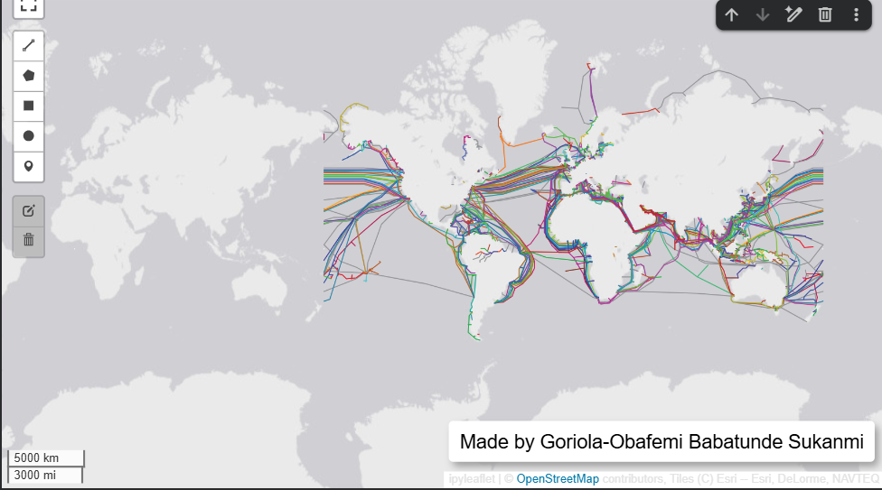

# Lab 1: Interactive Mapping with leafmap

GEOG-414 Spatial Management, United Nations University

Created an interactive web map using leafmap, displaying submarine cable
lines from TeleGeography's live cable map API over a light gray Esri
basemap, with custom text and logo overlays.

Note: the assignment's original data source and basemap (open.gishub.org
and CartoDB.DarkMatter) were both intermittently unreachable during
development, likely due to a real, transient DNS issue on the data host
and a CARTO API key policy change affecting free basemap access. The map
below uses TeleGeography's own live API and Esri's WorldGrayCanvas basemap
instead, which proved reliable.

Colab notebook: https://colab.research.google.com/drive/1j8nYlrP1xO3WFI8TE56oDruGSN-4DlVU?usp=sharing
